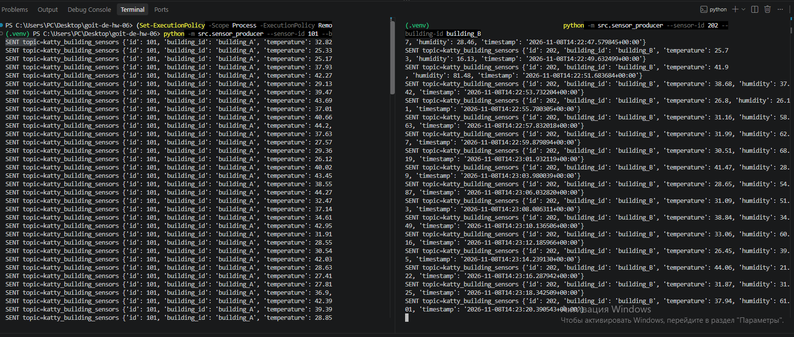
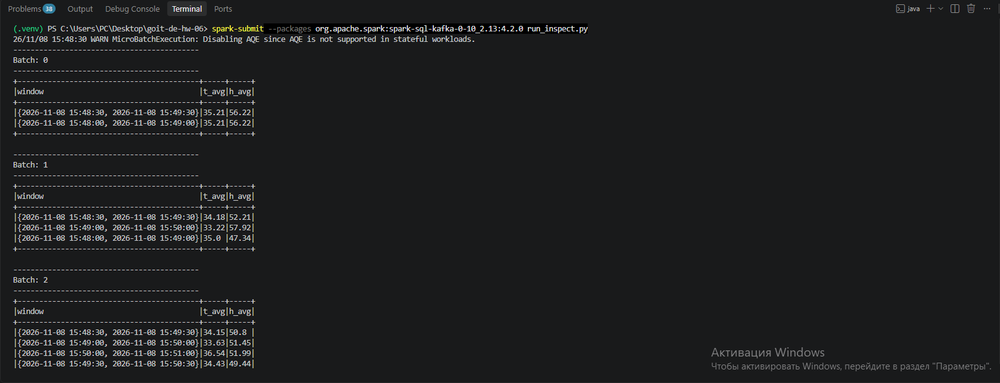

Spark Structured Streaming and Kafka Alerts

1. Objective

Implement a sensor-data streaming pipeline using two Kafka producers, Apache Spark Structured Streaming, and a Kafka alert topic. Compute average temperature and humidity in one-minute event-time windows sliding every 30 seconds, apply a 10-second watermark, evaluate the official CSV alert conditions, and publish matching alerts to Kafka.

2. Environment and components

Windows; Java 17.0.12; PySpark 4.2.0; Kafka connector org.apache.spark:spark-sql-kafka-0-10_2.13:4.2.0. Input topic: katty_building_sensors. Output topic: katty_streaming_alerts. Two producer instances use sensor IDs 101 (building_A) and 202 (building_B).

3. Alert rules

Code

Condition

Message

101

Humidity 0–40%

It’s too dry

102

Humidity 60–100%

It’s too wet

103

Temperature −300 to 30°C

It’s too cold

104

Temperature 40–300°C

It’s too hot

The value −999 in both minimum and maximum fields disables that metric for a particular rule. The rule table was loaded from data/alerts_conditions.csv, as observed in the Spark output.

#Screenshots

##Kafka Sensor Producers — Simultaneous Data Generation

Description:

This screenshot demonstrates two independent Kafka producers running simultaneously in separate VS Code terminals.

Sensor 101 generates temperature and humidity readings for building_A.

Sensor 202 generates temperature and humidity readings for building_B.

Both producers publish messages to the Kafka topic katty_building_sensors.

Each message contains a sensor ID, building ID, temperature, humidity, and timestamp.

Sensor readings are generated continuously, simulating real-time IoT data streams.

Result: Successful implementation of two concurrent Kafka producers transmitting sensor data to the input Kafka topic.

2. Apache Spark Structured Streaming — Sliding Window Aggregation

Description:

This screenshot demonstrates real-time processing of Kafka sensor data using Apache Spark Structured Streaming.

The application calculates:

Average temperature (t_avg).

Average humidity (h_avg).

Aggregated measurements within 1-minute sliding windows, updated every 30 seconds.

Streaming results across successive micro-batches (Batch 0, Batch 1, and Batch 2).

The displayed results confirm that Spark successfully processes incoming sensor readings and updates the aggregated values as new data arrives.

For example, one window reports:

Average temperature: 34.18°C

Average humidity: 52.21%

The main alert-processing pipeline additionally uses a 10-second event-time watermark to manage late-arriving data.

Result: Successful verification of real-time sliding-window aggregation using Spark Structured Streaming.

3. Kafka Alert Consumer — Real-Time Alert Detection

Description:

This screenshot demonstrates successful alert delivery through the Kafka streaming pipeline.

The Spark application evaluates aggregated temperature and humidity values against predefined alert conditions loaded from alerts_conditions.csv.

When a window's average measurements satisfy an alert condition, the application generates an alert and publishes it to the output Kafka topic katty_streaming_alerts.

The Kafka consumer successfully receives multiple alerts containing:

Alert code: 104

Alert message: It's too hot

Average temperature: 45.0°C

Average humidity: approximately 45–50%

Window: start and end timestamps

Timestamp: alert generation time

The alerts were generated using controlled high-temperature sensor readings to verify the alert-processing functionality.

Result: Successful end-to-end verification of the Kafka–Spark–Kafka pipeline, including alert detection and delivery to the output Kafka topic.

